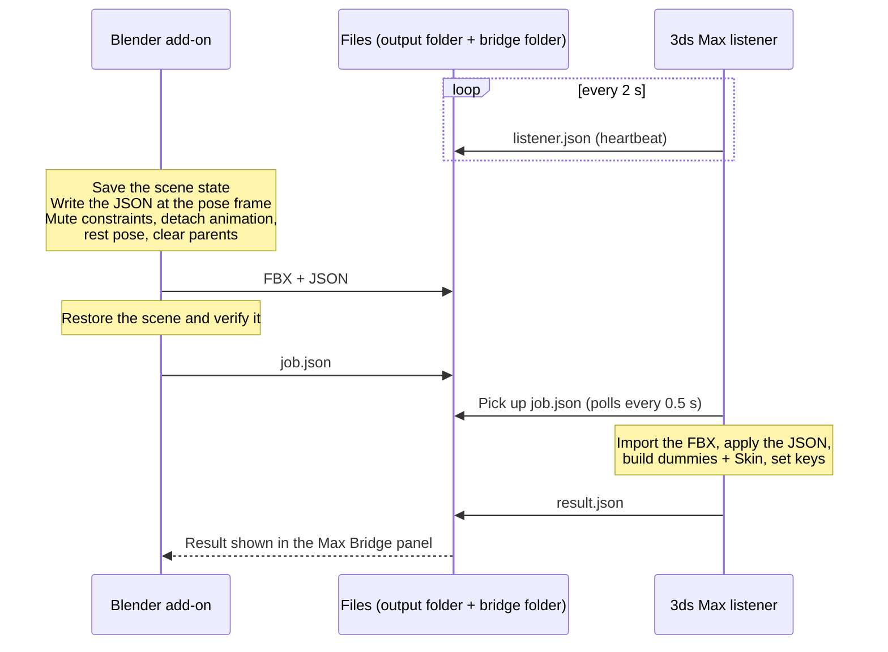

# Blender <-> 3Ds Max Bridge Advanced

**One bridge, both ways.** Send a Blender scene to 3ds Max with one button, and bring a 3ds Max scene back to Blender, with the setup intact: hierarchy, pivots, Euler rotation orders, transforms, keyframe animation, collections and layers, meshes, materials, and rigs. Blender armatures arrive in 3ds Max as **Dummy + Skin** setups with your painted weights, or as **exact bones** with the Blender bones' axes and keys; a 3ds Max Skin arrives in Blender as an **armature** with the same bones and weights. Each side checks the result against values the other side wrote, so you see exactly where (if anywhere) it differs.

[](LICENSE)


[](https://www.youtube.com/watch?v=JLfaM6lJrOw)

▶️ **[Video demo](https://www.youtube.com/watch?v=JLfaM6lJrOw)** · [earlier demo of Blender → 3ds Max (2.x)](https://youtu.be/yLYJzMyWv8I)

It unites the two one-way tools: **Blender → 3ds Max Bridge 2.5.1** ([BlenderTo3DsMax](https://github.com/IuriiKruglov/BlenderTo3DsMax)) and **3ds Max → Blender Bridge 0.9**. Everything both of them do is in it, plus a **Reset** button on both sides.

Created by Claude (Anthropic) under the leadership of Kruglov Iurii.

## Download

| Part | File | Runs in |
|---|---|---|
| Blender add-on (both directions) | [`blender_max_bridge.py`](blender_max_bridge.py) | Blender 3.6 LTS – 5.2 |
| 3ds Max script (both directions) | [`BlenderMaxBridge.ms`](BlenderMaxBridge.ms) | 3ds Max 2022 – 2026 (*Send to Blender*: 2024 – 2026) |
| Scene scan (diagnostics, optional) | [`tools/MaxSceneScan.ms`](tools/MaxSceneScan.ms) | 3ds Max 2024 – 2026 |

Download them from the latest release (*Releases* on the repository page, under *Assets*), or open each file above and press **Download raw file** (the download icon above the code). Then follow [Installation](#installation).

The add-on and the script are also on [Gumroad](https://tricky3d.gumroad.com/l/Blender-3DsMax-Bridge-Advanced).

---

## Contents

- [Download](#download)
- [How it works](#how-it-works)
- [Features](#features)
- [Requirements](#requirements)
- [Installation](#installation)
- [Quick start](#quick-start)
- [Reset](#reset)
- [Blender add-on reference](#blender-add-on-reference)
- [3ds Max script reference](#3ds-max-script-reference)
- [Bridge folder](#bridge-folder)
- [Blender → 3ds Max in detail](#blender--3ds-max-in-detail)
- [3ds Max → Blender in detail](#3ds-max--blender-in-detail)
- [Performance](#performance)
- [Limitations](#limitations)
- [Troubleshooting](#troubleshooting)
- [Repository layout](#repository-layout)
- [Version history](#version-history)
- [Contributing](#contributing)
- [Credits](#credits)
- [License](#license)

---

## How it works

Both apps share one **bridge folder** (default `%LOCALAPPDATA%\BlenderMaxBridge`).

**Blender → 3ds Max** is one button. The geometry travels as an **FBX** file and everything else as a **JSON** file:
- **FBX:** static, unparented, axis-correct, skinned meshes in their rest pose.
- **JSON:** hierarchy, rotation orders, transforms, the exact keyframes, collections, bones and skin weights.

A listener inside 3ds Max picks up each export, imports the FBX, rebuilds the rest from the JSON key by key, and writes the result back to Blender:



**3ds Max → Blender** is two buttons. *Send to Blender* in 3ds Max writes the scene (or the selection) into `<bridge folder>\FromMax`: a `.json` with the scene and a `.bin` with the meshes, normals, map channels and skin weights, plus `latest.json` pointing to it. *Import latest from 3ds Max* in Blender reads it:

```mermaid
sequenceDiagram
    participant M as 3ds Max script
    participant F as FromMax subfolder
    participant B as Blender add-on
    Note over M: Read nodes, layers, meshes (as 3ds Max shows them),<br/>normals, materials, Skin, keys,<br/>and the values to check against
    M->>F: <scene>.json + .bin + .log, latest.json
    B->>F: Import latest from 3ds Max
    Note over B: Build objects, collections, meshes,<br/>armatures, keys; check world matrices,<br/>boxes and skinned meshes against 3ds Max
```

Your Blender scene is left exactly as it was when you send it: everything the export changes is put back, and the add-on verifies it afterwards.

---

## Features

### Blender → 3ds Max

#### Objects and animation
- **Hierarchy** is rebuilt with 3ds Max parenting. It does not matter in which pose the parent was when you parented (for example in the middle of an animation): Blender's parent inverse matrix is taken into account.
- **Rotation orders** are kept. Each Blender rotation mode (XYZ, XZY, YZX, YXZ, ZXY, ZYX) becomes a 3ds Max *Euler XYZ* controller with the same axis order.
- **Quaternion and axis-angle objects** are converted to Euler XYZ, keeping the rotation continuous between keys.
- **Keyframes are transferred one to one.** Location goes to *Position XYZ*, rotation to *Euler XYZ* and scale to *Bezier Scale*.
  - Keys land on the same frame numbers, sub-frames included.
  - Only the axes you keyed in Blender get keys. No extra keys appear on X or Y if you only keyed Z.
  - Rotation keys follow Blender's own channel values: whole turns (a wheel keyed 0° → 720° turns twice), angles past ±90° and gimbal-locked poses (exactly ±90° on the middle axis of the rotation order) arrive as keyed.
- **Collections become layers**, nested like in Blender.
- **Units:** centimeters are recommended in 3ds Max. In a scene with other units the listener asks whether to switch the scene to centimeters (objects already in it keep their size) or to rebuild the Blender scene in the scene's own units (2.5). Either way the mesh sizes are checked against Blender's. See [Scene units](#scene-units).
- **Time line:** the 3ds Max time line is extended to Blender's frame range (it is never shortened).

#### Armatures
- **Bones:** every deform bone becomes a 3ds Max **Dummy** named like the bone.
  - Orientation: **Z forward, Y up**.
  - Scale: 100 %.
  - The bone hierarchy is kept.
- **Skin:** every mesh deformed by an Armature modifier gets a **Skin** modifier.
  - It is bound to those dummies in Blender's rest pose.
  - It uses the painted weights, normalized exactly like Blender's Armature modifier normalizes them.
- **Bone animation becomes dummy keys.** Tangents follow Blender's keys (flat, linear, constant); see [Bind pose, pose and keys](#bind-pose-pose-and-keys).
  - Optional per-frame bake.
  - Armatures with bone constraints, bone drivers or NLA strips are always baked.
- **Objects parented to a bone** are parented to that bone's dummy.
- **Exact bones** (option, 2.4): every bone becomes a **3ds Max bone** with the Blender bone's own axes (Y along the bone), linked like in Blender, with no armature object. Its controllers are *Freeze Transform* layers, so the rest pose reads as zero and the keys carry Blender's own values. See [Exact bones](#exact-bones).
- **Preserve Volume** turns on the Skin's *Dual Quaternion* skinning (2.4).
- **Bones linked to objects** (2.5): a root bone that follows an object with a *Child Of* constraint becomes a child of that object in 3ds Max, as a dummy or an exact bone, with no constraint and its own keys. A mesh with several Armature modifiers gets one Skin. Dummies of such rigs point Y up and Z to the front. See [Bones linked to objects](#bones-linked-to-objects-assemblies).

#### One-button bridge
- **Send to 3ds Max** does the whole job:
  1. Saves the scene state.
  2. Writes the JSON.
  3. Prepares and exports the FBX with fixed settings.
  4. Restores the scene exactly.
  5. Notifies 3ds Max.
- **Result in Blender:** the 3ds Max result, including warnings, is shown in Blender's panel.
- **Re-sending replaces the previous import.** This is optional, and safe: old objects are deleted only after the new FBX imported successfully.
- **Manual mode:** export the files only, then import them in 3ds Max with *Import JSON…*.
- **Autostart (optional):** the listener can start automatically with 3ds Max.

#### Fast import in 3ds Max
- The JSON is read in one call and parsed by an iterative parser.
- Lookups use dictionaries, and the name-to-node table is built once.
- No exception-based `return`, `continue` or `exit` inside loops.
- Undo, Auto Key and viewport redraw are off while applying.
- Per-phase timings are printed to the MAXScript Listener.

### 3ds Max → Blender

- **Hierarchy, groups and pivots.** Every node becomes an object with the same name, parent and local transform; the Blender origin is the 3ds Max pivot (the object offset is applied to the mesh). Mirrored and non-uniform scales stay object transforms. Groups become Empties.
- **Layers become collections** (nested, hidden, frozen, not renderable), under one collection named after the .max file.
- **Meshes exactly as 3ds Max shows them** (modifier stack baked), quads and n-gons rebuilt from the hidden triangle edges, hard edges and (option) custom normals from 3ds Max's own normals, every map channel, material IDs and smoothing groups as attributes.
- **Live Shell / TurboSmooth** at the top of the stack become Solidify / Subdivision Surface, checked against 3ds Max's final vertices.
- **Materials** become Principled BSDF with color, metalness, roughness, opacity and bitmaps.
- **Splines** become Bezier curves.
- **Skin becomes an armature**: dummies, points and 3ds Max bones that a Skin uses become the bones (no Empties), with their animation, children and bind pose; bones linked to different objects follow them with *Child Of*. Bones made by Blender → 3ds Max come back with their Blender axes.
- **Keys stay keys** (Bezier handles fitted to values 3ds Max wrote), Euler orders kept; what can't be kept as keys is baked per frame.
- **Units:** real size in the Blender scene's units, or 1 3ds Max unit = 1 Blender unit, or a custom factor.
- **Checked:** world matrices of every node on the first frame and of animated nodes every N frames, mesh bounding boxes, live modifiers and skinned meshes, all against values 3ds Max wrote.

### Both directions

- **One bridge folder** for both directions, set once in each app.
- **Reset** in both apps puts the bridge back to idle after an error, a freeze or a hang. See [Reset](#reset).

---

## Requirements

| Component | Requirement |
|---|---|
| Blender | 3.6 LTS – 5.2, with the bundled FBX exporter (`io_scene_fbx`; the add-on enables it if needed) |
| 3ds Max | 2022 – 2026, with the bundled FBX importer. *Send to Blender* is made and tested for 3ds Max 2024 – 2026 |
| System | Windows (3ds Max). Blender and 3ds Max must see the bridge folder and the exported files **under the same paths**, which normally means the same computer |

---

## Installation

### Blender add-on
1. Download `blender_max_bridge.py`. Keep this exact file name, because it is the Python module name. A name with dots in it cannot be imported.
2. Install it from disk:
   - **Blender 4.2 – 5.2:** *Edit → Preferences → Add-ons*, then the **⌄** menu at the top right, then *Install from Disk…*, and pick the file.
   - **Blender 3.6 – 4.1:** *Edit → Preferences → Add-ons → Install…*, and pick the file.
3. Enable **Blender <-> 3Ds Max Bridge Advanced** (category *Import-Export*).
4. Optional: set a different **Bridge folder** in the add-on preferences. The default is `%LOCALAPPDATA%\BlenderMaxBridge`.

**Replacing the one-way add-ons.** *Blender -> 3ds Max Bridge* has the same file name, so installing this file updates it in place. *3ds Max -> Blender Bridge* (`max_to_blender_bridge.py`) is switched off automatically when this add-on starts, and the *Bridge* panel says so: remove it in *Preferences → Add-ons*. Its settings (import options) start from their defaults again.

### 3ds Max script
1. Save `BlenderMaxBridge.ms` in a permanent folder. Autostart refers to this path.
2. Run it with *Scripting → Run Script…*, or drag it into a viewport. The **Blender <-> 3Ds Max Bridge Advanced** window opens, with three parts: *Bridge folder and Reset*, *Blender -> 3ds Max (receive)* and *3ds Max -> Blender (send)*.
3. Press **Start listening** to receive from Blender.
4. Optional: tick **Start the listener automatically when 3ds Max starts**.

**Replacing the one-way scripts.** `BlenderMaxBridge.ms` 2.x has the same name: replace it and run the new one once (an enabled autostart is pointed at the new file automatically). Stop using `MaxToBlenderBridge_v0.x.ms`; its *Send to Blender* is part of this script now. Running this script closes the windows of both old scripts.

Both sides use the same default bridge folder. If you change it on one side, change it on the other side too.

### Updating
- **Blender:** install the new `.py` over the old one.
- **3ds Max:** replace `BlenderMaxBridge.ms` with the new one and run it once. If autostart is on and you saved the new script under another name or folder, autostart is re-pointed to it automatically.

---

## Quick start

| Blender: *Max Bridge* tab (3D Viewport sidebar, **N**) | 3ds Max: the bridge window |
| :---: | :---: |
|  |  |

**Blender → 3ds Max**
1. In **3ds Max**, run the script and press **Start listening**. It shows *Listener: waiting for Blender*.
2. In **Blender**, open the 3D Viewport sidebar (**N**) and go to the **Max Bridge** tab. The *Blender -> 3ds Max* panel shows **3ds Max listener: online**.
3. Press **Send to 3ds Max**. The panel reports the progress:
   1. *Exported … objects …*
   2. *Waiting for 3ds Max…*
   3. *3ds Max picked up the job, importing…*
   4. *3ds Max: N objects (A animated) in T s, D dummies, S skinned*
4. In 3ds Max, the imported objects and dummies are selected. The MAXScript Listener shows the time spent in each phase.

Press **Send** again after changes in Blender. With *Replace same-named objects* on, the previous import is replaced instead of duplicated.

**3ds Max → Blender**
1. In **3ds Max**, in *3ds Max -> Blender (send)*, choose *Whole scene* or *Selection* and press **Send to Blender**. Esc cancels, also in the middle of a big object; the window names the object being written.
2. In **Blender**, in the *3ds Max -> Blender* panel of the **Max Bridge** tab, the first line names the scene 3ds Max sent. Press **Import latest from 3ds Max**.
3. The report goes to `<scene>.import.log` next to the JSON and to the text block *Max to Blender Import* (*Show report*).

---

## Reset

Use **Reset** when the bridge got stuck: an error, a freeze, a hang, a panel that keeps waiting. Each app has its own Reset; it puts that side back to idle and does not change your scene data.

| Reset in | What it does |
|---|---|
| **Blender** (*Max Bridge* tab → *Bridge* panel, or *Stop waiting (Reset)* in the status box while waiting) | Stops waiting for 3ds Max, so *Send to 3ds Max* works again. Withdraws a job 3ds Max has not picked up yet (`job.json`, and a half-written `job.json.tmp`). Clears the status. Ends a progress bar or a busy cursor left behind. If 3ds Max had already picked the job up, it says so: then reset 3ds Max too |
| **3ds Max** (*Bridge folder and Reset* → **Reset**) | Stops the listener and starts it again if it was on, and clears its busy state. Answers a job Blender is waiting for (a job not picked up, or one whose import did not finish), so Blender stops waiting and shows *Reset in 3ds Max…*. Turns scene redraw back on (every *disable* left by an interrupted import is matched), ends a progress bar, and allows Esc again. Gives objects that an interrupted *Replace* renamed `…__BlenderBridgeOld` their names back. Closes the `.bin` and log files an interrupted *Send to Blender* left open. Reads the settings again and forgets the answer to the scene-units question of this session |

Since 3.0 a job that crashes in 3ds Max outside the import itself is answered at once, too, so Blender does not wait half an hour for it.

---

## Blender add-on reference

All of it is in *3D Viewport → Sidebar (N) → Max Bridge*, in three panels.

### Panel *Blender -> 3ds Max*

| Item | Description |
|---|---|
| **3ds Max listener: online / offline** | Online if the 3ds Max listener wrote its heartbeat less than 10 s ago. With script 2.5 the line also names the 3ds Max scene units when they are not centimeters, e.g. *online (scene in inches)* |
| **Send to 3ds Max** | Exports the FBX and JSON, restores the scene and sends the job to 3ds Max |
| Status box | Progress and the 3ds Max result, with up to 6 warnings |
| **Objects** | *All visible* (all objects visible in the current view layer, the default) or *Selected* |
| **Pose frame** | Frame at which the static pose (FBX transforms and JSON values) is taken. Default 0, which is the frame 3ds Max reads the import at |
| **Output folder** | Where the `.fbx` and `.json` are written. Empty means next to the `.blend` file, or `<bridge folder>\exports` if the file is not saved |
| **File name** | Base name of the `.fbx` and `.json`. Empty means the `.blend` file name (`untitled` if not saved) |
| **Replace same-named objects in 3ds Max** | Default on. 3ds Max deletes objects, bone dummies and Skin helpers whose names match this export, but only after the new FBX imported successfully |
| **Bones -> Dummies + Skin** | Default on. Converts armatures as described in [Armatures to Dummies and Skin](#armatures-to-dummies-and-skin). Off: armatures go into the FBX as Blender bones. Reads *Armatures -> Bones + Skin* while *Exact bones* is on |
| **Exact bones** | Default off (2.4). Every bone becomes a 3ds Max bone with the Blender bone's axes, hierarchy and keys, with no armature object; see [Exact bones](#exact-bones). Needs the 3ds Max script 2.4 |
| **Bake bone keys every frame** | Default off. Keys the dummies (or exact bones) on every frame of the scene range, but only on axes that move |
| Resolved path | Shows where the files will be written |
| **Export FBX + JSON only** | The same export, without notifying 3ds Max |
| Folder button | Opens the output folder |

### Panel *3ds Max -> Blender*

| Item | Description |
|---|---|
| First line | The scene 3ds Max sent last (`FromMax\latest.json`) and when, or *Nothing sent from 3ds Max yet* |
| **Import latest from 3ds Max** | Imports that scene |
| **Import file…** | Imports any `.json` written by *Send to Blender* (also files of the 0.2 – 0.7 scripts) |
| **Units** | *Real size* (default: 3ds Max units → meters, in this scene's *Unit Scale*), *3ds Max units* (1 unit = 1 Blender unit) or *Custom* (a factor) |
| **Custom Normals** | On (default): 3ds Max's normals as custom normals, exactly its shading. Off: the same hard edges, Blender's normals |
| **Animation** / **Keep single keys** | Import the keys; a track with one key becomes the static value unless *Keep single keys* is on |
| **Materials** | Principled BSDF materials |
| **Rebuild quads / n-gons** | Dissolve the hidden edges of the 3ds Max triangles |
| **Skin -> Armature** / **Dummies -> Bones** / **Bone keys** | Skin as an armature; the dummies, points and 3ds Max bones a Skin uses become its bones; bones that follow objects get a key on every frame instead of a constraint |
| **Frame rate and range** | Take them from 3ds Max |
| **Check against 3ds Max** / **Check live modifiers** / **Check skin** | The checks of [Verification](#verification-always-on-by-default) |
| Summary + **Show report** | The last import's summary, and its report in a Text Editor |

### Panel *Bridge*

| Item | Description |
|---|---|
| Name, version, folder | The add-on and the bridge folder it uses |
| **Reset bridge** | See [Reset](#reset) |
| Gear button | Opens the add-on preferences |

### File menus
- *File → Export → Send to 3ds Max (FBX + JSON)* does the same as the panel button.
- *File → Export → Blender JSON (.json)* writes only the JSON (selected objects by default). It writes no FBX and sends no job.
- *File → Import → 3ds Max -> Blender (.json)* imports a file written by *Send to Blender*, with the import options in the file browser.

### Add-on preferences
- **Bridge folder** is the folder shared with 3ds Max, for both directions: the job, result and heartbeat files of *Send to 3ds Max*, and in its subfolder `FromMax` the scenes 3ds Max sends.

---

## 3ds Max script reference

One window, *Blender <-> 3Ds Max Bridge Advanced 3.0*, with three parts.

### Bridge folder and Reset

| Control | Description |
|---|---|
| **Bridge folder** + **…** | Must match the Blender preference. Stored in `<3ds Max plugcfg>\BlenderMaxBridge.ini` (section `[Bridge]`, key `Folder`) |
| **Reset** | See [Reset](#reset). A message lists what it did |

### Blender -> 3ds Max (receive)

| Control | Description |
|---|---|
| **Start listening** / **Listening… (click to stop)** | Starts or stops the listener (a Windows Forms timer on the UI thread, polling every 0.5 s) |
| **Start the listener automatically when 3ds Max starts** | Writes `BlenderMaxBridge_AutoStart.ms` into the user startup scripts folder. On startup it loads this script and starts listening without opening the window |
| **Scene units** (2.5) | What to do when the scene is not in centimeters: *Ask* (default), *Switch the scene to centimeters*, or *Keep the scene units (rebuild in them)*. Stored in the same `.ini` (key `Units`). The line below shows the current scene units. See [Scene units](#scene-units) |
| **Last import** | Result of the last job, and the number of warnings |
| **Import JSON…** | Manual import of a bridge JSON without Blender |
| **Import the FBX named in the JSON** | Imports the FBX next to the JSON first. Off: the JSON is applied to objects already in the scene |
| **Replace same-named objects (with FBX only)** | Same as Blender's *Replace* option, for manual imports |

All messages go to the MAXScript Listener with the prefix `[Blender->Max Bridge]`. A successful import ends with a timing summary like this one:

```
[Blender->Max Bridge] Done: <objects> objects (<animated> animated) in <t> s, <bones> bones, <dummies> dummies, <skinned> skinned
[Blender->Max Bridge]   read+parse JSON <t> s, FBX <t> s, apply <t> s, bones/skin <t> s
```

Running the script again while it is listening replaces the old listener cleanly, and listening continues.

### 3ds Max -> Blender (send)

| Control | Description |
|---|---|
| **Scope** | *Whole scene* or *Selection (with its parents)* |
| **Animation** | Keys; baked where they can't be kept |
| **Materials** | Material data and bitmaps |
| **Skin -> Blender armature** | Bones, bind matrices and weights of the Skins |
| **Keep Shell / TurboSmooth live** / **Check them against 3ds Max** | Live modifiers at the top of the stack, and their final vertices for the check |
| **Check every N frames** | World matrices of animated nodes every N frames (and at every key) for the check |
| **Log every object** | A log line per object |
| **Output** | *Bridge folder \FromMax* (default; Blender: *Import latest from 3ds Max*) or *File* (any `.json`; `latest.json` points to it too) |
| **Send to Blender** | Writes `<scene>.json`, `.bin`, `.log` and `latest.json`. Esc cancels |
| **Open log** / **Show folder** | The log of the last export, and its folder |

---

## Bridge folder

Default: `%LOCALAPPDATA%\BlenderMaxBridge`, set in the Blender add-on preferences and in the 3ds Max window.

| File | Written by | Content |
|---|---|---|
| `listener.json` | 3ds Max, every 2 s while listening (deleted when stopped) | Heartbeat: `app`, `max_version`, `bridge` (the script version), `listening`, `units`, `cm_per_unit`. Blender reads its modification time, `bridge` before sending Exact bones, and `units` for the panel |
| `job.json` | Blender, atomically (temporary file + rename) | `format` (`BlenderMaxBridgeJob`), `version`, `id`, `created`, `fbx`, `json` (absolute paths), `replace`, `objects`, `blender`, `source` |
| `result.json` | 3ds Max, atomically, with retries | `id`, `status` (`ok` / `error`), `message`, `seconds`, `objects`, `warnings` |
| `exports\` | Blender | The FBX and JSON of *Send to 3ds Max* when the `.blend` is not saved (else they go next to it, or to the *Output folder*) |
| `FromMax\<scene>.json`, `.bin`, `.log` | 3ds Max (*Send to Blender*) | The scene, its binary data (meshes, normals, map channels, weights, check vertices) and the export log |
| `FromMax\latest.json` | 3ds Max | `json` (the last export), `exported`, `generator`. *Import latest from 3ds Max* reads it |
| `FromMax\<scene>.import.log` | Blender | The import report |

| Timing | Value |
|---|---|
| Listener poll / Blender result poll | 0.5 s |
| Listener considered online | Heartbeat younger than 10 s |
| Job withdrawn if not picked up | after 30 s (listener offline) or 180 s (listener online but busy) |
| Blender stops waiting for a result | after 30 min (or at once with *Reset* in either app) |
| 3ds Max ignores a job file older than | 15 min |

While 3ds Max imports, its timer is paused, so the heartbeat pauses too. Blender knows the job was picked up and keeps waiting.

---

## Blender → 3ds Max in detail

### What happens on Send

#### In Blender

1. **Checks.** If an object is in NLA tweak mode, the export stops.
2. **Saves the scene state:**
   - frame and sub-frame, selection and active object;
   - parents (type, bone, vertices, parent inverse matrix);
   - raw transform values in every rotation mode;
   - actions and action slots, fake-user flags, NLA and driver states;
   - constraint mute states, including bone constraints;
   - the armatures' *Pose Position*.
3. **Writes the scene data at the pose frame:** objects, collections and armature data. Bone animation is evaluated by Blender itself, at every frame that has a bone key.
4. **Prepares the FBX export:**
   - mutes all constraints;
   - detaches actions (protected with a fake user, so none is lost) and disables NLA and drivers;
   - switches converted armatures to *Rest Position*, so deformed meshes are exported in their bind pose;
   - clears parents with **Keep Transform**;
   - selects the exported objects.
5. **Reads skin weights** from the evaluated meshes, the same meshes the FBX exporter writes, so vertex indices match.
6. **Writes** the JSON, then exports the FBX with the settings below.
7. **Restores** everything from step 2, then compares every object's world matrix with the original. A difference above 0.0001 is reported as a warning.
8. **Writes `job.json`** atomically and waits for the 3ds Max result.

#### FBX export settings (fixed)

| Setting | Value |
|---|---|
| Limit to | Selected Objects |
| Object types | Empty, Camera, Lamp, Mesh, Other, plus Armature only when *Bones -> Dummies + Skin* is off |
| Custom Properties | Off |
| Scale | 1.00 |
| Apply Scalings | All Local |
| Forward / Up | **Y Forward / Z Up** |
| Apply Unit | On |
| Use Space Transform | On |
| Apply Transform | **On** (bakes the axis and unit conversion into the objects, so no object gets an extra rotation or scale) |
| Bake Animation | Off (animation travels in the JSON) |
| Path Mode / Batch Mode | Auto / Off |

#### In 3ds Max (one job)

1. **Reads and deletes `job.json`.** Jobs older than 15 minutes, and repeated job ids, are ignored.
2. **Parses the JSON.**
3. **Checks the scene units** (2.5). Not centimeters: asks, or follows the listener setting; see [Scene units](#scene-units).
4. **Imports the FBX:**
   - Mode *Add*, Animation off, Up axis Z.
   - Your own FBX importer settings are pushed before the import and restored after it.
   - In a scene that is not in centimeters, the system units are set to centimeters for the moment of the import, then the new objects are rescaled to the scene units.
   - With *Replace*, same-named nodes are first renamed out of the way (`…__BlenderBridgeOld`). They are deleted after a successful import, or get their names back if the import fails.
5. **Sets the time slider to 0, resolves the unit factor** (see [units](#units)) **and checks the mesh sizes** against Blender's.
6. **Creates the bone dummies** (or the exact bones, with their Freeze Transform layers) in the bind pose.
7. **Applies the objects:**
   - rotation order, rotation, scale and parenting;
   - rotation and scale keys, then location keys;
   - layers.

   Undo, Auto Key and viewport redraw are off during this step.
8. **Adds the Skin modifiers** and writes the weights.
9. **Animates the dummies:** pose values first, then keys (exact bones: on their zero layers). Then puts the dummies and bones on their layers.
10. **Selects the result and writes `result.json`** for Blender.

---

### Armatures to Dummies and Skin

#### Dummy axes

Each dummy uses its bone's axes turned **+90° around the bone's X axis**:

| 3ds Max dummy axis | Blender bone axis |
|---|---|
| X | X |
| **Y (up)** | Z (the bone's "up", set by its roll) |
| **Z (forward)** | −Y (pointing from the tail towards the head) |

For a bone pointing backwards (+Y), the dummy's Z points forward and its Y points up. A constant rotation per bone does not change the deformation, because the Skin modifier only uses each dummy's motion relative to its bind pose.

Dummies of rigs with [bones linked to objects](#bones-linked-to-objects-assemblies) (2.5) take the bone's axes turned in 90° steps so that **Y points up in the scene and Z to the front**, whatever way the bone points. Every dummy made by the bridge carries the Blender bone's axes in its user property `BlenderBoneAxes` (the bone's X, Y and Z as dummy axes, `x,-z,y` for the plain axes above), so the 3ds Max → Blender bridge (0.9) gives the bones back their own axes.

#### Which bones become dummies

These bones become dummies:
- all **deform bones**;
- their parent bones;
- bones that have objects parented to them.

Other bones, such as IK targets or controls, are not converted. If nothing in an armature needs converting, it is skipped with a warning.

Each dummy gets a display box of 10 % of its bone length (at least 0.5 system units). Its scale is always 100 %.

#### Hierarchy

- **Bone chain.** Child bone dummies are linked to their parent bone dummies, as in Blender.
- **Root bone dummies** are linked to the object the armature is parented to, if that object is exported. Otherwise they are linked to the world. A root bone that follows an object with *Child Of* is linked to that object instead (2.5).
- **The armature object itself** does not become a node, unless it is animated (object keys, object constraints or transform drivers). Only then does it become a Dummy named after the armature, and the root bones are linked to it.
- **Objects parented to the armature** are linked to the armature's parent, or to the armature dummy if one exists.
- **Objects parented to a bone** are linked to that bone's dummy.

#### Bind pose, pose and keys

Every value is computed by Blender from `pose_bone.matrix`, which already includes parents, inheritance, constraints, drivers and NLA. Each value is written as the dummy's **local** position, Euler XYZ rotation and scale relative to its 3ds Max parent.

1. **Bind pose.** The mesh is exported in the armature's *Rest Position*. The dummies are created in the rest pose, and the Skin modifier is bound in that pose.
2. **Pose.** The dummies then get their values at the pose frame. This keeps bones you posed without keys.
3. **Keys.** Dummies are keyed at the frames where the bone has keys, per channel group: location, rotation and scale. Rotation uses the channels of the bone's rotation mode (quaternion, Euler or axis-angle).
   - Axes that do not move get no keys.
   - Scale uses *Bezier Scale*, which stores X, Y and Z in one key.

Tangents follow Blender's keys:

| Blender key | 3ds Max tangent |
|---|---|
| Constant interpolation | Step |
| Linear interpolation | Linear |
| Bezier with a flat handle | Flat |
| Anything else | Auto |

**Baking.** The dummies are keyed on every frame of the scene range, on the axes that move, in two cases:
- when **Bake bone keys every frame** is on;
- automatically, when the armature has bone constraints, drivers on bones, NLA strips, or bones with *Inherit Rotation* off or *Inherit Scale* other than *Full*.

#### Weights

- **Source.** Weights are read from the vertex groups that match **deform** bones of the armature driving the mesh. Other vertex groups are ignored.
- **Normalization.** Each vertex's weights are divided by their sum, exactly like Blender's Armature modifier does. A vertex painted 0.5 on a single bone moves fully with that bone in Blender, so it gets weight 1.0 in 3ds Max.
- **Unweighted vertices.** If a vertex's total weight is 0.0001 or less, Blender does not deform it. Such vertices are bound to a helper dummy, `<mesh>__SkinStatic`, linked to the mesh, so they follow the mesh like in Blender. The helper is created only when needed.
- **Skin settings.** The Skin modifier keeps its default settings, except *Dual Quaternion*: it is on when Blender's Armature modifier has *Preserve Volume* on, and off otherwise (2.4; 2.3 left it as the new modifier had it). Weights are written with `skinOps.ReplaceVertexWeights`, which needs the Modify panel, so the command panel switches to *Modify* for a moment during the import.

#### Not converted (you get a warning)

- **B-Bone** curvature (Segments > 1). The bone deforms as a straight bone.
- **Envelope** weights. Only vertex-group weights are used.
- The Armature modifier's **vertex group mask**.
- **More than one Armature modifier** on a mesh: one Skin gets the bones of all of them (2.5; 2.4 converted only the first). Their masks are left out, so the weights blend all bones like one Armature modifier.
- **A bone and an object with the same name**, or **bones with the same name in two armatures.** 3ds Max links bones by name.

---

### Exact bones

**Exact bones** (2.4, under *Bones -> Dummies + Skin*, which then reads *Armatures -> Bones + Skin*) sends armatures as the same bone rig as in Blender:

| | Dummies (default) | Exact bones |
|---|---|---|
| Node | Dummy | 3ds Max bone |
| Which bones | Deform bones, their parents, bones with child objects | Every bone of the armature; the deform bones go into the Skin |
| Axes | Bone axes turned +90° about X (Z forward, Y up) | The Blender bone's own axes: Y along the bone, X and Z as set by its roll |
| Armature object | None, unless it is animated (then a Dummy) | None, unless it is animated (then a Dummy) |
| Controllers | *Position XYZ*, *Euler XYZ*, *Bezier Scale* with the local values | *Freeze Transform* layers: the rest pose is zero and the keys are Blender's values |

#### Bones

- Made with 3ds Max's own bone tool and named like the Blender bones. Length = Blender bone length; width and height 10 % of it, taper 90 %, no fins.
- 3ds Max builds bone geometry along the node's X axis. The object offset turns it onto Y, so the bone points where the Blender bone points while the node keeps the Blender bone's axes.
- *Bone On* (auto-align, stretch) is off, so a bone moves only as its controllers say, like in Blender. Bones do not render. Bones hidden in Blender are hidden.

#### Hierarchy

As in Blender, without the armature object: child bones are linked to their parent bones, and root bones to the object the armature is parented to (or to the world).

```
Blender:  Engine  →  Armature_01  →  Bone_01  →  Bone_02        (parent → child)
3ds Max:  Engine  →  Bone_01  →  Bone_02
```

Objects parented to a bone are linked to that bone. Objects parented to the armature are linked to the armature's parent. Only an animated armature object (object keys, constraints or transform drivers) keeps a Dummy named after it, so that its keys stay as they are.

#### Freeze Transform layers

Each bone's controllers are built the way 3ds Max's *Freeze Transform* builds them:

| Controller | Layer | Holds |
|---|---|---|
| *Position List* | Frozen Position | Rest position relative to the parent (bind pose) |
| | **Zero Pos XYZ** (active) | Blender's location, in the parent's axes |
| *Rotation List* | Frozen Rotation | Rest rotation relative to the parent |
| | **Zero Euler XYZ** (active) | Blender's rotation. Euler bones keep their values and their rotation order; quaternion and axis-angle bones get Euler XYZ |
| *Bezier Scale* | — | Blender's scale (times the armature's scale for root bones under a scaled armature) |

So *Transform To Zero* puts the rig into Blender's rest pose, and the keys are Blender's keys:
- **Euler rotation and scale:** the same frames and the same values on the same axes. Rotation keyed on only some axes stays on those axes, because the zero layer turns in the bone's own frame, exactly like Blender's channels.
- **Quaternion and axis-angle rotation:** keys at Blender's rotation key frames, as Euler XYZ, continuous from key to key.
- **Location:** the same keys when the bone's rest frame is its parent's frame turned by multiples of 90° (axes only swapped or flipped, as for bones lined up with their parent's axes); otherwise Blender's location in the parent's axes, keyed at the frames of all its location keys.
- **Baked rigs** (constraints, drivers, NLA, partial inheritance, or *Bake bone keys every frame*): the zero layers get a key on every frame, from the evaluated pose.

3ds Max applies the zero rotation in the frozen (local) frame and adds up the positions in the parent's frame, so

```
local = T(frozen + zero position) · R(frozen) · R(zero) · S(scale)   (Blender convention)
      = rest_relative · T(location) · R(rotation) · S(scale)         = Blender's pose bone
```

#### Skin

The Skin is bound in the rest pose (zero layers at 0), with the deform bones and the normalized weights, as with dummies.

The 3ds Max script must be 2.4 or newer. When the listener runs an older script, the add-on stops before sending and says so.

---

### Bones linked to objects (assemblies)

In an assembly the bones of one skin hang under different objects. In the CSLM12 gun mount, `CSLM12_Belt` is skinned by two bones: `CSLM12_Bone_gun` moves with `CSLM12_Hull` (the turret) and `CSLM12_Bone_box` with `CSLM12_Base`. In Blender (as the 3ds Max → Blender bridge 0.9 builds it) that is one armature under `CSLM12_Base` whose root bones follow their objects with **Child Of** constraints:

```
Blender:  CSLM12_Base → CSLM12_Belt_Armature (CSLM12_Bone_gun, CSLM12_Bone_box)
          CSLM12_Bone_gun: Child Of CSLM12_Hull      CSLM12_Bone_box: Child Of CSLM12_Base
3ds Max:  CSLM12_Base → CSLM12_Arm → CSLM12_Hull → CSLM12_Bone_gun
          CSLM12_Base → CSLM12_Bone_box
          CSLM12_Belt: Skin (CSLM12_Bone_gun, CSLM12_Bone_box)
```

A root bone counts as linked when its only active constraint is a plain *Child Of*: full influence, every location / rotation / scale channel, owner space *Pose*, target space *World*, inverse set, and the bone is where that constraint puts it. Its target must be exported (an object, or a bone of another converted armature).

- **3ds Max node:** the bone's dummy (or exact bone) is a child of the target, with no constraint and no armature node. Its local transform under the target is `inverse · rest · basis` (Blender's *Child Of*: bone world = target world · inverse · pose matrix), so it moves with the target, and its own keys stay keys. A *Child Of* link alone does not make the rig baked any more.
- **Skin:** bound in the armature's rest pose, as in Blender. With exact bones, a bone whose target has moved since the inverse was set is posed at that bind for the moment of binding (`bind_zero`), then gets its pose.
- **Several Armature modifiers** on one mesh (one armature per bone, each masked by its bone's group) become one Skin with all their bones, blending them like one Armature modifier.
- **Dummy axes:** turned in 90° steps so that Y points up and Z to the front (see [Dummy axes](#dummy-axes)). Exact bones keep the Blender bone's axes.

Two armatures with masked modifiers (the hand-made CSLM12 layout) blend their bones one modifier after the other. With *Preserve Volume* that differs from one Skin with dual quaternion when the turret turns: up to 10.7 mm on the 861 mm belt for a turn of 30°. One armature with *Child Of* on each bone (as the 3ds Max → Blender bridge 0.9 builds it) blends like the 3ds Max Skin.

---

### Scene units

The bridge works in **centimeters**: Blender's FBX comes in centimeters, and the 3ds Max scenes it was tested in are in centimeters. When the 3ds Max scene uses other units, the listener (2.5) asks before importing:

| Answer | What happens |
|---|---|
| **Yes: switch to centimeters** | *Rescale World Units* rescales the objects already in the scene so they keep their size, and the system units become centimeters (1 unit = 1 cm). Then the import runs as in a centimeter scene |
| **No: keep the scene units** | The Blender scene is rebuilt in the scene's units (inches, meters, millimeters, a custom unit scale…) |
| **Cancel** | Nothing is imported |

The answer is kept until 3ds Max closes. *Scene units* in the 3ds Max window (*Blender -> 3ds Max (receive)*) makes it permanent (*Switch the scene to centimeters* or *Keep the scene units*), or brings the question back (*Ask*).

With the scene units kept, the FBX is imported while the system units are set to centimeters for that moment, so the FBX importer converts nothing (its conversion can end up in the node scales, which the bridge then sets to Blender's). Then the new objects are rescaled to the scene units with *Rescale World Units* (positions and geometry), checked object by object, and every value from the JSON is multiplied by `U` (see [Units](#units)). Finally the size of every mesh is checked against Blender's (`size` in the JSON); a difference above 0.1 % is a warning.

---

### Rotation, position and unit math

#### Objects

```
W  = R1(a1) · R2(a2) · R3(a3)      rotation from the JSON Euler angles, in the object's rotation-mode order
L  = W · inverse(W_parent)          local rotation relative to the parent
static rotation:  Blender's own Euler values, set before linking (they are exactly the world rotation W),
                  then 3ds Max links the node and keeps its world transform
rotation key k:   key(k−1) + (Blender value(k) − Blender value(k−1))   when that is the same rotation all along the step,
                  otherwise Blender's motion is followed in steps of at most 30°, each taking the
                  equivalent Euler triple nearest to the previous one (so turns and direction survive)
location keys:    local = (location × U) · inverse(parent.transform)
```

The first rotation key starts from the static values 3ds Max holds after linking. Axes you did not key in Blender keep those values. If the parent's orientation would make them move as well, you get a warning (see [Limitations](#limitations)).

| Blender rotation mode | 3ds Max Euler XYZ `axisOrder` |
|---|---|
| XYZ | 1 (XYZ) |
| XZY | 2 (XZY) |
| YZX | 3 (YZX) |
| YXZ | 4 (YXZ) |
| ZXY | 5 (ZXY) |
| ZYX | 6 (ZYX) |

The object values in the JSON are Blender's raw transform values. When a child was parented while its parent had the pose it has at the pose frame (the usual case), those values are the child's world values at the pose frame, and the formulas above apply as written.

When the parent had another pose at parenting time (parented in the middle of an animation, or the parent moved afterwards), Blender keeps the child in place through the child's *parent inverse* matrix, and the raw values are no longer world values. For such objects the add-on (2.3) also sends `parent_space`, the matrix M with

```
world(object) = world(3ds Max parent) · M · basis(object)        (Blender convention, constant over time)
```

The 3ds Max script (2.3) then uses

```
W  = R(channels) · rot(M) · W_parent        static world rotation
L  = R(channels) · rot(M)                   local rotation of every key
location keys:  local = (location × U) · M   (3ds Max row-vector convention, translation × U)
```

For objects parented to a bone dummy, M also contains the dummy axes and the bone tail (for an exact bone, only the bone tail), and is taken in the bind pose, in which the FBX and the dummies are linked. Versions up to 2.2 always assumed raw values = world values.

#### Bone dummies
The dummies' local values are computed directly in Blender, as described above, and written to *Position XYZ*, *Euler XYZ* (axis order XYZ) and *Bezier Scale*. Exact bones: see [Freeze Transform layers](#freeze-transform-layers).

#### Units
- `unit_to_cm = 100 × Unit Scale`, or 100 if Blender's unit system is *None*. This is the same factor Blender's FBX exporter uses with *Apply Unit*, so the FBX numbers are centimeters.
- `U = unit_to_cm ÷ (centimetres per 3ds Max system unit)`. This works for any system unit and system unit scale.
- In a scene that is not in centimeters (2.5): the FBX comes in at 1 unit = 1 cm, then the new objects are rescaled by `1 ÷ (centimetres per system unit)`; see [Scene units](#scene-units).
- After the FBX import, the script measures the actual factor on the imported objects (imported position ÷ Blender location). The measured factor is used, with a warning, when all three conditions hold:
  - at least 3 objects can be measured;
  - 60 % of them agree within 0.5 %;
  - the result differs from `U` by more than 1 %.

  Location keys and dummies then always match the geometry, even with unusual FBX importer unit settings.

---

### JSON format (version 5)

The JSON is compact: one object per line, plain decimals only. Version 3 adds the `armatures` and `skins` sections to the version-1 layout, so older importers can still read the objects. Version 4 (2.4) adds exact-bone armature records and the Skin's `dq` flag. Version 5 (2.5) adds bones linked to objects, the dummies' `bone_axes`, exact bones' `bind_zero`, the meshes' `size`, `units` and the Skin's `armatures`.

#### Top level

```json
{
"format":"BlenderMaxBridge","version":5,"generator":"Blender 4.2.23 LTS / blender_max_bridge 2.5",
"source":"engine_rig.blend","fbx":"engine_rig.fbx","pose_frame":0,"fps":24,
"frame_start":0,"frame_end":81,"unit_to_cm":100,"units":{"system":"METRIC","scale_length":1},
"objects":{ ... },
"collections":{"layers":{"Helicopter":""},"objects":{"Engine_L":"Helicopter", ...}},
"armatures":{ ... },
"skins":{ ... }
}
```

| Key | Meaning |
|---|---|
| `fbx` | FBX file name next to the JSON (empty for a JSON-only export) |
| `pose_frame` | Frame of the static pose |
| `fps`, `frame_start`, `frame_end` | Scene timing. Keys keep their frame numbers, and an fps mismatch produces a warning |
| `unit_to_cm` | Blender units to centimetres |
| `units` | Blender's unit system and *Unit Scale* (2.5, for the record) |
| `collections.layers` | Collection name → parent collection name (`""` for top level) |
| `collections.objects` | Object name → collection name |

#### Object record

Illustrative example:

```json
"Hatch_01":{"parent":"Hull","rotation_mode":"ZXY",
 "location":[0.42,-1.35,1.1],"rotation_euler":[1.5707963268,0,0],"scale":[1,1,1],
 "animation":{"location":{"X":[],"Y":[],"Z":[]},
              "rotation_euler":{"X":[],"Y":[],"Z":[{"frame":12,"value":0},{"frame":20,"value":-2.0943951024}]},
              "scale":{"X":[],"Y":[],"Z":[]}}}
```
Rotations are in radians, and keys are `{"frame", "value"}` per axis. Meshes also carry `"size"` (2.5): the diagonal of their local bounding box in Blender units, as the FBX has them (armatures in rest), which 3ds Max checks its meshes against.

Objects parented while their parent had another pose also carry `"parent_space"` (add-on 2.3): the first three rows of a 4×4 matrix in Blender's column-vector convention, translation in Blender units (see [math](#objects)). Importers that do not know the field ignore it.

```json
"Chassis_L_04":{"parent":"Chassis_L_02","rotation_mode":"ZXY", …,
 "parent_space":[[1,0,0,-0.7228335738],[0,0,1,-0.7212077379],[0,-1,0,0.6823562384]]}
```

#### Armature record

Example (two-bone engine rig, float noise rounded):

```json
"Engine_Rig_L":{"node":false,"parent":"Engine_L","bake":false,
 "world":{"location":[0.5687630773,6.923017025,2.2164149284],"rotation":[0,0,0],"scale":[1,1,1]},
 "bones":[
  {"name":"Engine_Bone_L02","parent":"Engine_Bone_L01","deform":true,"length":0.4193217754,
   "rest":{"location":[0,0,-0.9721029401],"rotation":[0,0,0],"scale":[1,1,1]},
   "pose":{"location":[0,0,-0.9721029401],"rotation":[0,0,0],"scale":[1,1,1]},
   "world_rotation":[1.5707963705,0,0],
   "animation":{"location":{},"rotation":{},
                "scale":{"X":[{"frame":42,"value":1,"to":"flat"},{"frame":43,"value":1,"ti":"flat","to":"flat"},
                              {"frame":50,"value":1.1817185879,"ti":"flat","to":"flat"},{"frame":51,"value":1.1817185879,"ti":"flat"}],
                         "Y":[ ... ],"Z":[ ... ]}}}
 ]}
```

| Key | Meaning |
|---|---|
| `node` | `true` if the armature object becomes a Dummy (it is animated) |
| `parent` | 3ds Max parent of the root bone dummies (a root bone linked to an object names that object as its own `parent`) |
| `bake` | Keys are sampled on every frame |
| `world` | Armature world transform, used when `node` is true |
| `bones` | Ordered with parents first |
| `rest` / `pose` | Local position (Blender units), rotation (Euler XYZ, radians) and scale, in the bind pose and at the pose frame |
| `world_rotation` | Bind-pose world rotation of the dummy, used for objects parented to the bone |
| `bone_axes` | The Blender bone's X, Y and Z as axes of the dummy, e.g. `x,-z,y` (2.5). The 3ds Max script writes it to the dummy's user property `BlenderBoneAxes` |
| `animation` | Dummy-local keys per axis. `ti` / `to` are the in / out tangent types (`flat`, `linear`, `step`, `auto`) |

**Exact bones** (version 4): the armature record has `"mode":"exact"`, and every bone has these fields instead of `pose` and `animation`:

```json
  {"name":"HALAMCA_Engine_Bone_R02_LOD0","parent":"HALAMCA_Engine_Bone_R01_LOD0","deform":true,"length":0.4193217754,"hide":false,
   "rest":{"location":[0,0.9721031189,0],"rotation":[0,0,0],"scale":[1,1,1]},
   "zero_order":"XYZ",
   "zero_pose":{"location":[0,0,0],"rotation":[0,0,0],"scale":[1,1,1]},
   "world_rotation":[1.5707963705,0,0],
   "zero_animation":{"location":{},"rotation":{},
                     "scale":{"X":[{"frame":42,"value":1,"to":"flat"}, ... ],"Y":[ ... ],"Z":[ ... ]}}}
```

| Key | Meaning |
|---|---|
| `rest` | Frozen layers: rest position and rotation (Euler XYZ, radians) relative to the 3ds Max parent, in the bone's own axes; rest scale |
| `zero_order` | Rotation order of the Zero Euler XYZ layer (the bone's Euler order, `XYZ` for quaternion bones) |
| `zero_pose` | Zero layers and scale at the pose frame |
| `zero_animation` | Zero-layer keys per axis (location in the parent's axes, rotation in `zero_order`), with tangent types as above |
| `hide` | The bone is hidden in Blender |
| `bind_zero` | Zero layers that put a bone linked to an object at its Skin bind, when that is not the frozen pose (2.5) |

#### Skin record

Example:

```json
"Engine_L":{"armature":"Engine_Rig_L",
 "bones":["Engine_Bone_L01","Engine_Bone_L02"],
 "vertices":136,"static_vertices":0,
 "weights":[[0,1],[0,1],[1,1], ...]}
```
`weights` holds one list per vertex, in FBX vertex order, as `[bone index, weight, bone index, weight, …]`. The weights are normalized, and an empty list marks a vertex that Blender does not deform. `"dq":true` (version 4) means *Preserve Volume*: the Skin's *Dual Quaternion* toggle is turned on. `armatures` (version 5) lists every armature whose bones the Skin uses (several Armature modifiers); `armature` is the first of them.

---

## 3ds Max → Blender in detail

**Tested on real scenes** (3ds Max 2024 → Blender 3.6.12, 4.2 and 5.2):
- **fuse.max:** 2,512 nodes, 4.45 M triangles. Export 2 min, import 25 s. 7,039 world-matrix checks over 76 frames found 0 differences, and all 2,429 mesh bounding boxes match.
- **OH-2B Shuriken.max** (selection, 787 nodes): 807 animated curves, 18,741 Bezier segments, all fitting. 17,764 world-matrix checks over 98 frames found 0 differences, and all 731 boxes match.
- **HALAMCA.max / 20240311_SU57.max** (exported with 0.4, re-imported with the 0.5 add-on): the Euler repair puts the keys of the 11 HALAMCA and 2 SU57 objects with non-XYZ orders on their axes. 865 + 2,440 world-matrix checks find 0 differences (before: 13 and 2 objects off, up to 1.3 m), and all 62 + 255 boxes match.
- **Normals** (0.7.1, HALAMCA.max): the reader passed its box test and read all 56 meshes (all with explicit normals) in 0.1 s, with no Edit Normals modifier; the shading in Blender 3.6.12 is the one 3ds Max shows.
- **Assembly rig** (0.9, CSLM12_Skin.max: `CSLM12_Belt` skinned by `CSLM12_Bone_gun` under the Hull and `CSLM12_Bone_box` under the Base, Blender 4.2 and 5.2): one armature under `CSLM12_Base`, *Child Of* `CSLM12_Bone_gun` → `CSLM12_Hull` and `CSLM12_Bone_box` → `CSLM12_Base`, one Armature modifier with *Preserve Volume*. Turning the Hull 30° about each axis, the Arm 20°, moving the Base, and all three together: the bones follow their objects within 0.00024 mm, and the belt matches 3ds Max's Skin math (dual quaternion blend of the two bones' motions) within 0.0002 mm (linear: 0.0007 mm). The hand-made two-armature layout gives the same belt with linear skinning but drifts up to 10.7 mm with dual quaternion.
- **Skin → armature** (0.8, HALAMCA.max engines, 2 Skins on 4 bone dummies, re-imported in Blender 4.2 and 5.2): no dummy Empties; 2 armatures under their engine meshes, R01 → R02 connected (R01 0.9721 m long), R02's own scale keys on its bone, 0 of 859 world-matrix checks off (bones included), skinned engines within 0.0024 mm of 3ds Max. Also checked on synthetic rigs built with 3ds Max's math: a dummy between two Skin bones, binds turned against their parent, a root bone under an animated point, two Skins sharing bones, a mesh used as a bone, objects linked to bone dummies, Euler keys on all three axes and non-uniform scale keys.

### What arrives

| 3ds Max | Blender |
|---|---|
| Node pivot (node transform) | Object origin. The object offset (pivot moved away from the geometry) is applied to the mesh in 3ds Max, so nothing has to be reset. |
| Local transform | Same location, Euler angles (same order letters: Max XYZ = Blender XYZ) and scale, parent inverse = identity. Mirrored nodes keep their negative scale (3ds Max and Blender both decompose a mirror as all three scales negative). |
| Scale axis (scaled or mirrored in world / parent coordinates; 3 objects in fuse.max) | The PRS values can't rebuild the matrix, so a static node takes the local matrix as is (exact). A keyed one is baked. |
| Sheared local matrix (rare: non-uniform scale on a scale axis, partial inheritance) | Closest location/rotation/scale; the shear part goes into the object data and the children's parent inverse, so geometry and children stay exact. |
| Groups (nested) | Empties (plain axes) with `max_group_head`, `max_group_open`; members are children. |
| Dummies, points, other helpers, cameras, lights | Empties (cube for dummies, axes otherwise); the class is kept as `max_class`. |
| Dummies, points and 3ds Max bones that a Skin uses | Bones of the Skin's armature, with their animation; no Empties (see *Skin → Armature*). |
| Layers (nested, hidden, frozen, not renderable) | Collections under one collection named after the .max file. A hidden layer is hidden and not rendered, as in 3ds Max. |
| Mesh (whole modifier stack, or the part below live modifiers / Skin) | The mesh exactly as 3ds Max shows it (read with `snapshotAsMesh`; for mirrored nodes the script probes whether 3ds Max reverses the faces and turns them back). The quads and n-gons are rebuilt from the hidden triangle edges. Shading: see below. Material IDs become material slots and the face attribute `max_mat_id`; smoothing groups become the face attribute `max_sg`. Map channels: see below. The stack is listed in the `max_mods` property. |
| Instances | One mesh shared by the objects that share the base object, the same (instanced) modifiers and the same pivot offset. |
| Materials | Principled BSDF: color, metalness, roughness, opacity and bitmaps when the files exist. Multi/Sub-Object becomes one slot per material ID. Instances with different materials get object-linked slots. Missing materials appear magenta. |
| Splines | Bezier curves: knots, handles, straight segments and closed state. Renderable thickness becomes bevel. |
| Units, frame rate, range | *Real size* by default: 3ds Max units → meters, in the Blender scene's *Unit Scale* (0.9: with Unit Scale 0.01 a 3 m object is 300 Blender units, shown as 3 m). Options: 1 3ds Max unit = 1 Blender unit, or a custom factor. fps and range are set. See *Units*. |
| User properties, wire color | `max_user_props`, object color. |

#### Map channels

Every map channel arrives, as an FBX import would bring it:

| 3ds Max | Blender |
|---|---|
| UV channels 1–99 | UV maps, named as in 3ds Max (the *Channel Info* / FBX names kept in the user properties, e.g. `MapChannel:1 = UVMap`), else `UVChannel_1`, `UVChannel_2`…; channel 1 (the lowest) is the active and render UV map. Blender holds 8 UV maps: further channels become corner attributes (U, V, W) of the same name for the *Attribute* node. A channel that uses W also gets the corner attribute `<name>_W`. |
| Vertex color (0) and vertex alpha (−2) | Color attribute `Col` (RGB from channel 0, alpha from channel −2; alpha alone gives white `Col`). |
| Illumination (−1) | Color attribute `Illum`. |

---

### Live modifiers (Shell, TurboSmooth)

Only the Shell / TurboSmooth modifiers at the **top** of a 3ds Max stack become Blender modifiers; the mesh below them is baked. Disabled modifiers are skipped. A Shell or TurboSmooth under any other enabled modifier is baked with the rest of the stack. To find the mesh below the run, the script switches the run off for a moment and restores it; the scene's "save changes" state is kept. *Keep Shell / TurboSmooth live* (on by default) turns it off, and then everything is baked as before.

| 3ds Max | Blender |
|---|---|
| TurboSmooth | Subdivision Surface: levels = iterations, render levels = render iterations when set, *limit surface* off (classic Catmull-Clark, like TurboSmooth). Off in viewport / renders carries over. |
| … *Separate by Smoothing Groups* | Crease 1.0 and a hard edge on every edge between faces that share no smoothing group, and *Use Creases* on for this level only. A TurboSmooth with *Smooth Result* gives every face one group, so a TurboSmooth above it has no seams left: its Subdivision ignores the creases (Blender carries a crease up through every level; 0.5 kept them, and a TurboSmooth > TurboSmooth stack stayed faceted). |
| … *Separate by Materials* | Crease 1.0 on material borders. |
| … *Smooth Result* | All faces soft; hard edges stay only where TurboSmooth separates. Without *Smooth Result* the smoothing groups stay as they are. |
| Shell | Solidify, Complex mode: thickness = inner + outer, offset = (outer − inner) / (inner + outer), rim filled; *Straighten Corners* → thickness mode Constraints. A separating TurboSmooth above it gets creased rim borders. |
| … *Auto Smooth Edge* (angle) | Hard rim above the angle: the mesh's auto smooth angle on Blender 3.6–4.0 (it then also applies to the rest of that mesh), or Blender's *Smooth by Angle* modifier on 4.1+. |

Not transferred: Shell segments above 1 (rim divisions), Shell material ID / smoothing overrides, Shell bevel. They are listed under *note* in the report.

**Check.** With *Check them against 3ds Max* on, the script also writes the final vertices of every live object. Blender compares its own result with them (nearest vertex, both ways); within 1e-4 of the object's size counts as matching. Where the result is off, Blender tries the other rule (Subdivision *Preserve Corners*; Solidify thickness *Even* or *Constraints*) and keeps whichever is closer, for every instance of that mesh. The report gives, per stack ("TurboSmooth", "TurboSmooth > Shell", …), how many meshes match, the median and worst deviation in mm, the rules that matched better, and the worst objects.

---

### Shading: hard edges always, Custom Normals as an option

It works like an FBX export and import. The script always sends 3ds Max's normals the way the FBX exporter writes them: the specified normals where a mesh has them (Edit Normals, Weighted Normals, normals imported with FBX / OBJ, models brought over from Blender), and normals from the smoothing groups everywhere else. In Blender every mesh gets its hard edges from them: an edge is hard where the normals of its two faces differ, which for a mesh shaded by smoothing groups means exactly the smoothing group seams. The **Custom Normals** checkbox (sidebar and import dialog) only decides the normals themselves:

| Custom Normals (Blender) | Result | FBX equivalent |
|---|---|---|
| **On** (default) | Hard edges as in 3ds Max plus its vertex normals baked in as custom normals: exactly the shading 3ds Max shows. | FBX import with *Custom Normals* on. |
| **Off** | The same hard edges; Blender computes the normals itself. No custom normals data, so the mesh is easy to remodel. | FBX import with *Custom Normals* off. |

**How 0.7 reads the normals.** A small C# reader (its source is inside the script) is compiled once per 3ds Max session against 3ds Max's own `Autodesk.Max.dll`: with the .NET Framework compiler on 3ds Max 2024–2025, and with Autodesk's `CSharpCompilationHelper` on 2026 and later (.NET 8 / 10). For every mesh it evaluates the node, takes its mesh (converted to a triangle mesh where needed), copies it and reads the normals of the copy (`MeshNormalSpec`), so no modifier is added, nothing is selected and the Modify panel is not touched. A mesh whose triangle or vertex count differs from the snapshot is not used. 0.5–0.6 added a temporary Edit Normals modifier to every mesh instead, which was the slow step of an export. If the reader can't be compiled, or the box test fails, the log says why, and meshes it can't read are shaded from their smoothing groups.

Why the hard edges come from the normals rather than from the smoothing groups alone: a mesh with explicit normals often has smoothing group 0 everywhere (HALAMCA and CS-LM12, and models that came from Blender). By its groups it would be flat, while 3ds Max shows it smooth through its normals.

Normals that are equal but stored separately count as one (compared as vectors). Every face is smooth, and the polygons are rebuilt only across edges whose normals agree. On Blender 3.6–4.0 the mesh uses auto smooth at 180°, so only the hard edges split the shading. Meshes without 3ds Max normals (files from scripts before 0.6, objects the reader can't read, space-warp bound objects) fall back to the smoothing groups: a face in group 0 is flat, and an edge between two faces that share no group is hard. The 3ds Max log names them with the reason, and the Blender report counts them. The groups are also kept on the faces as the integer attribute `max_sg`. Objects with live Shell / TurboSmooth are shaded from the groups, as described above, because Subdivision and Solidify rebuild the normals.

---

### Skin → Armature

A Skin modifier on top of the stack (or right under the live Shell / TurboSmooth) becomes an Armature modifier with the same bones and weights. Its bones can be bones, dummies (HALAMCA's engines), or any other objects (SU57's engines use bone chains, the CS-LM12 ammo belt uses two bones on the base and the turret). Elsewhere in the stack, a Skin is baked with the rest.

- **3ds Max side.** The Skin is read with `skinOps`, which needs the Skin shown in the Modify panel, so the script selects each skinned object for that moment and restores the selection and panel afterwards. It writes the bones (by node handle), their bind matrices and the mesh bind matrix (`skinUtils`), every vertex weight, the Dual Quaternion and Back Transform flags, and the mesh below the Skin. For the check, it also writes the skinned mesh at the export frame and at up to 3 frames where the bones move most, together with the bone and mesh matrices at those frames.
- **Blender side: one armature per skeleton.** Skins that share bones share one armature, named `<first mesh>_Armature`. The importer first checks where the root bones hang in 3ds Max (their *anchors*, the objects they are linked to). The armature hangs under the nearest common 3ds Max parent of the anchors and the skinned meshes, when every skinned mesh keeps still against it (else under the first mesh). For the engine rigs (HALAMCA: the bones under the engine mesh, which is also the skinned mesh) that is the anchor itself, so the rig is built as in 0.8. When a root bone's anchor is not the armature's parent (an assembly, see below), every root bone follows its anchor with *Child Of*. Every Skin bone is a bone, and the bone hierarchy follows the 3ds Max links (HALAMCA: R02 is a child of R01); a dummy or point linked between two Skin bones joins as a bone that does not deform. Each bone's rest pose is its bind frame. Weights become vertex groups named after the bones. The Armature modifier (named *Armature*) comes first in the stack, with *Preserve Volume* on for Dual Quaternion skins.
- **Dummies, points and 3ds Max bones become the bones** (*Dummies -> Bones*, on by default). Their objects are not created, so the rig is a plain Blender rig that can go back to 3ds Max as it was:
  - *Axes.* Dummies and points: bone = node frame turned −90° about X, so the bone's Y axis is the dummy's −Z. This is the inverse of the dummy axes of Blender → 3ds Max, so the way back gives the same dummies. Dummies made by Blender → 3ds Max 2.5 carry their Blender bone's axes in the user property `BlenderBoneAxes` (the bone's X, Y and Z as dummy axes, e.g. `z,x,y`), also when their axes were turned to point Y up and Z to the front; their bones come back with exactly those axes (0.9). 3ds Max bones (BoneGeometry, Biped, CAT) point where their geometry points: the bone's Y axis is the node's X axis, or that axis as the node's object offset turns it (0.8.1). Bones made by *Exact bones* of Blender → 3ds Max (2.4) keep the Blender bone's axes on the node, with the geometry turned onto Y, so they come back with exactly those axes. Every bone keeps `max_handle`, `max_name`, `max_class`, `max_kind` and `max_box` / `max_size` as custom properties.
  - *Length.* The dummy's box (or the point's size). A bone whose only child bone sits straight ahead on its axis reaches to it, and that child is connected when it is at its bind place and has no position keys (HALAMCA: R01 is 0.9721 m long, R02 connected).
  - *Animation.* The node's own 3ds Max keys move onto the pose bone, with their frames, values, handles and interpolation, mapped to the bone axes (location, Euler angles with the order letters mapped, scale), when the bind keeps the axes of the parent bone. A bone whose rotation has no keys uses Quaternion rotation, as Blender rigs do. Where the bind is turned against the parent bone, or an animated object sits between the armature and a root bone, the bone gets a key on every frame of the range (linear, only on the channels that move). The report counts both kinds.
  - *Children.* Objects linked to those nodes are parented to their bones (parent type *Bone*) and stay where they were.
- **Assemblies: bones linked to different objects** (0.9). In CSLM12 the belt is skinned by `CSLM12_Bone_gun` (linked to `CSLM12_Hull`, which turns) and `CSLM12_Bone_box` (linked to `CSLM12_Base`). 0.8 put the armature under the Hull, so the box bone turned with the turret. 0.9 builds what 3ds Max does:
  - one armature under the nearest common parent of the anchors and the skinned meshes (`CSLM12_Base`), and one Armature modifier per mesh, so the mesh blends all its bones like the one 3ds Max Skin (dual quaternion included);
  - a **Child Of** constraint on every root bone, targeting its 3ds Max parent: owner space *Pose*, target space *World*, every channel, the inverse set to the armature's place (`inverse = target⁻¹ · armature`, as *Set Inverse* gives). Blender then places the bone at `target world · inverse · pose matrix`, so it moves with its object, and turning the Hull or the Arm in Blender moves the belt as in 3ds Max;
  - the bones' own 3ds Max keys stay keys, relative to their 3ds Max parent (a key per frame where the bind is turned against it), and *Bone keys* leaves the *Child Of* constraints in place;
  - a skeleton whose root hangs under a dummy that became a bone of another armature follows that bone (*Child Of* with the bone as subtarget).

  This is the layout of `CSLM12_wanted_implementation.blend` with one difference: one armature with both bones instead of one armature per bone. Two Armature modifiers blend their bones one after the other; with dual quaternion that drifts from the 3ds Max Skin by up to 10.7 mm on the belt when the turret turns 30° (with linear skinning they agree).
- **Other objects used as Skin bones** (meshes, for example) stay objects, and their bones follow them with *Copy Transforms*, so animating or moving them drives the skin. A scaled or mirrored bind gets a small hidden helper Empty under the object. With *Dummies -> Bones* off, every bone works this way (the 0.7 rig).
- **Bind matrices are checked, not trusted.** The documentation does not say which matrices `skinUtils` returns (node or object matrix, object or pivot space). Every reading is tried against the skinned mesh 3ds Max wrote, using rigidly bound vertices, and the report names the reading that matched and by how much. If the bind matrices are missing or no reading fits, they are solved from the check frames instead.
- **Bone keys** (Blender option, off by default) keys the bones that follow objects on every frame of the range and removes their constraints.
- **Skin -> Armature** off in Blender, or a Skin that can't be converted: the mesh arrives as the skinned shape at the export frame.

The check compares the deformed mesh with 3ds Max's skinned mesh at the check frames, vertex by vertex; within 1e-4 of the mesh size counts as matching.

---

### Units (3ds Max → Blender)

The 3ds Max script writes the scene's system unit (`units {system, cm_per_unit}`, e.g. inches = 2.54 cm, a custom unit scale included) and every length in those units. With *Real size* (the default; it was called *Meters* before 0.9) a length becomes `cm_per_unit × 0.01 ÷ Unit Scale` Blender units, so the scene has its real size in the Blender scene's own units (*Scene › Units*: metric or imperial, with its *Unit Scale*). The report gives the conversion (`units: 3ds Max inches (1 unit = 2.54 cm) -> real size in this scene (metric, Unit Scale 0.01: 1 Blender unit = 1 cm): x2.54`) and its sizes in real millimeters and meters.

Checked (Blender 4.2 and 5.2) with the same synthetic scenes written in centimeters, inches, millimeters and meters, and imported into scenes with Unit Scale 1, 0.01 (metric) and 0.0254 (imperial): object and bone world matrices, bone lengths, Empty sizes, skinned vertices and keys agree with the centimeter import within 6e-7 m, and every check in the reports passes.

---

### Animation (3ds Max → Blender)

- **Keys stay keys.** This covers PRS with Position XYZ / Bezier or Linear Position, Euler XYZ (orders XYZ…ZYX), and ScaleXYZ / Bezier or Linear Scale, with Bezier or Linear float keys. Blender gets keys at the same frames, including sub-frames and keys outside the range.
- **Euler axes by name.** 3ds Max lists an Euler XYZ controller's sub-controllers in its axis order (ZXY: Z, X, Y). Its scripts up to 0.4 took that position for the axis, so with any order other than XYZ the keys landed on the wrong Blender axes (HALAMCA's hatches and chassis parts, SU57's machine-gun hatch). 0.5 identifies each sub-controller by its name (X_Rotation, …). For files from those older scripts, the add-on moves each track to the axis of its position in the order and logs how many tracks then equal 3ds Max's Euler angles at the export frame (HALAMCA: 25 of 25).
- **Handles are fitted, not trusted.** 3ds Max writes each key's value and the controller value at ¼, ½ and ¾ of every segment. Blender fits its Bezier handles to these values and checks the fit; segments that don't fit are counted in the report. Step tangents become Constant and Linear controllers become Linear.
- **Single keys.** A track with a single key animates nothing, so it becomes the static value (option: *Keep single keys*).
- **Baked when needed.** These are baked: lists, constraints (e.g. Path Constraint), expressions, scripts, TCB, IK, Biped, partial link inheritance, and a scale axis on a keyed node. Baking takes the local matrix at every frame of the range and keys only the channels that move.

---

### Verification (always on by default)

3ds Max writes three things for the check:
- the world matrix of every node at the first frame;
- the world matrix of every animated node at every Nth frame (*Check every N frames*, default 5) and at every key;
- the world bounding box of every mesh, as 3ds Max reports it (`node.min` / `max`: the object-space box with its 8 corners carried into world space, which is larger than the tight box for rotated objects).

After the import, Blender builds the same box and compares everything (the bones that replaced 3ds Max dummies are compared as those nodes; with *Animation* off, only the export frame), logging the objects that differ by more than 0.1 mm or 1e-4 in an axis, worst first. Both programs compute in 32-bit floats, so a node far down a chain of long translations also gets a small rounding allowance: 1e-6 of the chain's length (an SU57 camera image plane 1.35 km in front of a camera 1.3 km away may be 0.9 mm off). Such nodes are counted separately.

The report also logs *evidence lines*: 3ds Max tangent and unit conventions as measured on your keys. On fuse.max (30 fps), MAXScript's `outTangent` is the slope per frame divided by 5.333 (= 160 ticks / 30 fps). `inTangent` is the same with the sign reversed, and tangent lengths are fractions of the segment (1/3). The handles are fitted from sampled values anyway, so the import does not depend on this.

---

### Limits (3ds Max → Blender)

- Only Shell and TurboSmooth at the top of a stack stay live, and Skin on top or right under them. Every other modifier is baked (Symmetry → Mirror and Push → Displace could follow the same pattern).
- Objects with live Shell / TurboSmooth keep smoothing-group shading (no custom normals: Blender's Subdivision and Solidify rebuild them).
- Skin: Dual Quaternion becomes *Preserve Volume* on the whole mesh (no per-vertex DQ blend weights). Skin envelopes, Back Transform off with a moving mesh, and bone stretch are not reproduced; the check shows any difference.
- Skins that share bones but move against each other in 3ds Max (an animated object between the meshes): the armature hangs under the first mesh, and the others follow their own object's motion in Blender, not only their bones (the report warns).
- Skin bones: only nodes that a Skin uses (and dummies or points linked between them) become bones; a sheared node, or one with a Skin or live modifiers of its own, stays an object that its bone follows. The geometry of 3ds Max bones (width, height, fins) is not kept. IK, Biped and CAT motion arrives baked, as for any baked controller. So do Freeze Transform layers (list controllers), such as those of *Exact bones* of Blender → 3ds Max: the motion is exact, with a key on every frame; taking their zero layers back as Blender's pose bone keys is not done yet.
- Cameras and lights arrive as Empties; 3ds Max bones that no Skin uses arrive with their geometry. Morpher and visibility or modifier animation are not transferred.
- Rectangular renderable splines are approximated.
- Baked motion is exact on whole frames of the range; between frames it is linear.

---

### 3ds Max → Blender files (format version 3; 2 = no normals / skin, 1 = no live modifiers)

Written to `<bridge folder>\FromMax` (or to the file chosen in *File* mode); `latest.json` there points to the last one.

`<name>.json` (UTF-8; plain JSON numbers since 0.3):
`format` = `"max2blender"`, `version`, `generator`, `max_version`, `file`, `bin`, `units {system, cm_per_unit}`, `time {fps, ticks_per_frame, start, end, frame}`, `layers [{name, parent, hidden, frozen, renderable}]`, `materials {key: {name, class, color, metal, rough, opacity, maps, multi [[id, key, slot name]]}}`, `meshes {key: {at, nv, nf, maps [[channel, map verts]], nrm [at, count]}}`, `nodes [...]` in hierarchy order.
Each node has: `h` (handle), `name`, `parent`, `layer`, `kind`, `class`, `base`, `group_head` / `group_open` / `group_member`, `hidden` / `frozen` / `renderable`, `wire`, `props`, `local` and `world` (3ds Max matrix3 rows: X, Y, Z axis, translation; row vectors), `prs {pos, scale, quat, order, euler}`, `shear`, `inherit`, `offset`, `mesh`, `live [{class, name, views, renders, params}]` (lowest first; params = the modifier's numeric and on/off properties), `final {at, nv, nf}` (final vertices for the check), `skin {name, nv, pairs, at, dq, back_transform, always_deform, rigid, limit, mesh_bind, bones [{name, h, class, len, bind}], check [{frame, verts {at, nv}, mesh, mesh_obj, bones, bones_obj}]}`, `wbox` (3ds Max `node.min` / `max` of the final mesh), `shape`, `box` / `size`, `mtl`, `mods`, and `anim {mode: keys | bake, order, tracks [{ch, i, unit, ctrl, keys [[frame, value, in type, out type, in tangent, out tangent, in length, out length]], kv, seg}], bake {start, count, local}, verify {frames, world}}`.

`<name>.bin`: `M2BBIN1\0`, then per mesh at `at`, little-endian:
- `float32 verts[nv][3]` in pivot space, 3ds Max units;
- `uint32 faces[nf][5]`: 3 vertex indices, smoothing groups, and (material ID − 1) | hidden-edge bits << 16 (edge 1 = v1–v2, 2 = v2–v3, 4 = v3–v1 visible);
- per map channel (−2 alpha, −1 illumination, 0 vertex color, 1… UVW): `float32 mapverts[n][3]`, `int32 mapfaces[nf][3]`;
- 3ds Max normals at `nrm[0]`: `float32 normals[count][3]` (pivot space, unit length), `int32 corners[nf][3]` (normal index of every triangle corner, in the corner order of the faces). Unchanged in 0.7 and 0.8: files from the 0.6 and 0.7 scripts read the same way.

Final vertices (live check) at `final.at`: `float32 verts[nv][3]` in pivot space.
Skin weights at `skin.at`: `int32 count[nv]`, `int32 bone[pairs]` (0-based), `float32 weight[pairs]`. Skin check meshes at `check[].verts.at`: `float32 verts[nv][3]` in world space, 3ds Max units.

---

## Performance

The importer up to v1.1.1 was slow because of how it used MAXScript, not because of the math:
- `execute` for every number;
- `return` inside loops, which MAXScript implements with exceptions;
- key lookups that scanned dictionary keys on every frame;
- building the file string line by line;
- undo and redraw for every key.

Version 2.0 removes all of these and keeps the math identical; 2.2 then fixes the rotation math (see [Version history](#version-history)). The JSON is also smaller: 2.7× on the test scene (112 KB → 42 KB). Each import prints its phase timings to the MAXScript Listener. FBX import time depends on the geometry and is outside the script's control.

3ds Max → Blender: *fuse.max* (2,512 nodes, 4.45 M triangles) exports in 2 min and imports in 25 s; the normals reader reads HALAMCA's 56 meshes in 0.1 s.

---

## Limitations

### Blender → 3ds Max

- **Frame numbers are kept as they are.** A different frame rate in 3ds Max only produces a warning; time is not remapped.
- **Interpolation between keys.** Flat and constant curves match Blender exactly, and so do linear location and scale curves. Other curve shapes, and linear rotations, follow 3ds Max interpolation between keys (*Auto* tangents; quaternion bone rotations are interpolated as Euler). Values at the keys match (for one exception, see *Rotation keyed on only some axes* below). Use **Bake bone keys every frame** when the deformation must match on every frame. With *Exact bones*, Euler rotation and scale keys are Blender's own channels, so between keys only the tangent shapes can differ.
- **Object animation** is read from the active action only. NLA strips, drivers and constraints on objects are not converted; constraints are muted for the FBX and their effect is not baked.
- **Parenting types.** Object, armature and bone parenting are exact in any parenting pose. Vertex parents use the pose-frame relation only, and bones with *Relative Parenting* are treated as if the child was parented in the bind pose.
- **Rotation keyed on only some axes.** 3ds Max gets keys only on the axes you keyed. When the parent's orientation means the other axes would have to turn too, those poses cannot match, and the import warns with the object's name. Key X, Y and Z rotation in Blender for an exact match.
- **Skinning limits:** see [Not converted](#not-converted-you-get-a-warning). In addition:
  - Modifiers placed after the Armature modifier that change the vertex count are not supported.
  - A non-uniform scale on an armature object combined with rotated bones (shear) cannot be represented by 3ds Max PRS controllers.
- **Replace** deletes 3ds Max nodes whose names match the export: objects, bone dummies and `__SkinStatic` helpers. It does so only after a successful FBX import.
- **Bones and Skin need the FBX.** A JSON-only manual import (no FBX next to the JSON) skips them.


### 3ds Max → Blender

See [Limits (3ds Max → Blender)](#limits-3ds-max--blender).

---

## Troubleshooting

| Symptom | What to do |
|---|---|
| Blender shows *3ds Max listener: offline* | In 3ds Max, run the script and press **Start listening**. Check that both sides use the same bridge folder |
| *3ds Max did not pick up the job* | 3ds Max was not listening, or was busy for more than 3 minutes. The files are kept, so use *Import JSON…* in 3ds Max |
| *FBX was imported at X units per Blender unit (expected Y)* | Your FBX importer unit settings differ from the 3ds Max system unit. The import is still consistent, but check *Units* in the FBX importer |
| *N mesh(es) differ in size from Blender* | The FBX geometry did not come in at Blender's size in the scene units. Switch the scene to centimeters (3ds Max window, *Blender -> 3ds Max (receive)*: *Scene units*) and send again, and report the message |
| *N object(s) could not be rescaled to …* | *Rescale World Units* left these objects at centimeter size and they are not editable meshes. Switch the scene to centimeters and send again |
| *Not imported: the scene units question was cancelled* | Answer *Yes* (switch to centimeters) or *No* (keep the scene units), or set *Scene units* in the 3ds Max window |
| *Type error: Call needs function or class, got: undefined* (script 2.5) | A bug in 2.5: update `BlenderMaxBridge.ms` to 2.5.1 and run it once. Objects that 2.5 left renamed `…__BlenderBridgeOld` get their names back at the next send |
| Objects named `…__BlenderBridgeOld` in the scene | An import stopped after *Replace* had renamed them. Script 2.5.1 restores their names at the next send (or when an import fails); names already taken are reported |
| *N object(s) not found in the scene* | Objects were renamed or not imported. Re-send with *Replace* on |
| *Skin has N vertices, Blender M* | A modifier changed the vertex count after the export. Apply it in Blender, or move it before the Armature modifier |
| Skin step errors | Make sure the command panel is open. The script switches it to *Modify* while skinning |
| *Scene restore problems* / *objects moved by up to …* in Blender | Rare (for example, a locked or linked object). Undo once in Blender, then report the message in an issue |
| Autostart still loads an old script | Run the new script once. The autostart file is re-pointed automatically |
| *…: rotation is keyed on only some axes in Blender…* | Key all three rotation channels of that object in Blender (*I → Rotation*) and send again |
| Blender keeps *Waiting for 3ds Max…* | Press **Reset** in 3ds Max (it answers the job), or *Stop waiting (Reset)* in Blender |
| 3ds Max viewports stopped redrawing after an error | Press **Reset** in the 3ds Max window: it turns scene redraw back on |
| *Send to Blender* cannot write the `.bin` after a cancelled export | Press **Reset** in the 3ds Max window: it closes the file |
| *Nothing sent from 3ds Max yet* in Blender | *Send to Blender* in 3ds Max first, with the same bridge folder on both sides (Blender: add-on preferences; 3ds Max: *Bridge folder*) |
| A second *Max -> Blender* tab in Blender | The old *3ds Max -> Blender Bridge* add-on is still on: remove it in *Preferences → Add-ons* (3.0 switches it off when it starts) |

---

## Repository layout

| Path | Contents |
|---|---|
| [`blender_max_bridge.py`](blender_max_bridge.py) | Blender add-on, both directions |
| [`BlenderMaxBridge.ms`](BlenderMaxBridge.ms) | 3ds Max script, both directions |
| [`tools/MaxSceneScan.ms`](tools/MaxSceneScan.ms) | Read-only scan of a 3ds Max scene to JSON, for diagnosing *Send to Blender* (1.2) |
| [`LICENSE`](LICENSE) | GNU General Public License v3.0 |
| [`images/`](images) | Screenshots for this README |

The file names stay the same from version to version, so each update replaces the file and GitHub keeps every earlier version in the history.

---

## Version history

| Version | Changes |
|---|---|
| **3.0** | **Blender <-> 3Ds Max Bridge Advanced:** the two one-way tools in one add-on and one script, with one bridge folder (*Send to Blender* now writes into `<bridge folder>\FromMax`). The Blender add-on replaces *Blender -> 3ds Max Bridge* 2.5 (same file) and switches *3ds Max -> Blender Bridge* 0.9 off; the 3ds Max script replaces `BlenderMaxBridge.ms` 2.5.1 and `MaxToBlenderBridge_v0.7.1.ms`, in one window. **Reset** in both apps. A job that crashes in 3ds Max outside the import is answered at once. Everything else works as in 2.5.1 / 0.9: the same JSON (version 5) and job files towards 3ds Max, the same files (format version 3) towards Blender, the same results |

### Blender → 3ds Max Bridge (published as [BlenderTo3DsMax](https://github.com/IuriiKruglov/BlenderTo3DsMax))

A linked version number opens that repository as it was at that version (2.0 was not published on its own).

| Version | Changes |
|---|---|
| **2.5.1** | 3ds Max script only (the add-on stays 2.5). Fixes 2.5, which stopped every import with *Type error: Call needs function or class, got: undefined*: its FBX import step called a function the script had not defined yet at that point. Objects that *Replace* had renamed `…__BlenderBridgeOld` get their names back when an import fails, and each import first restores the names an interrupted import left. The mesh size check uses `node.min` / `node.max` |
| **2.5** | Add-on and 3ds Max script. **Bones linked to objects:** a root bone that follows an object with *Child Of* (assemblies such as the CSLM12 gun mount) becomes a child of that object in 3ds Max, as a dummy or an exact bone, with no constraint and its own keys instead of a per-frame bake. Several Armature modifiers on one mesh become one Skin. Dummies of such rigs point Y up and Z to the front (the bone's axes turned in 90° steps), and every bridge dummy carries the Blender bone's axes (`BlenderBoneAxes`) for the way back. **Scene units:** in a scene that is not in centimeters the listener asks to switch it to centimeters (existing objects keep their size) or to rebuild the Blender scene in its units; the FBX comes in without the FBX importer's own unit conversion, and the mesh sizes are checked. The heartbeat reports the scene units, and the Blender panel shows them. JSON version 5 |
| **2.4** | Add-on and 3ds Max script. **Exact bones** option: every bone becomes a 3ds Max bone with the Blender bone's own axes (geometry turned onto Y by the object offset, *Bone On* off), linked like in Blender with no armature object, and *Freeze Transform* layers holding the rest pose (frozen) and Blender's pose bone channels (zero layers), so the keys are Blender's keys. The Skin's *Dual Quaternion* toggle follows *Preserve Volume* in both modes. Warning for bones with the same name in different armatures. JSON version 4 |
| **2.3** | Add-on and 3ds Max script. Children parented while their parent had another pose than at the pose frame (for example parented in the middle of an animation, or without parent inverse) arrive in the right place and with the right rotation and location keys: the add-on sends `parent_space` for them, the 3ds Max script uses it. Also applies to objects parented to bones in a posed armature |
| [**2.2**](https://github.com/IuriiKruglov/BlenderTo3DsMax/tree/876e416c598ba528a8e956a91888f0bdb8ca0d43) | 3ds Max script only; the Blender add-on stays 2.1. Fixes objects rotated exactly ±90° on the middle axis of their rotation order (for example X = 90° in ZXY): 3ds Max turned them the wrong way while linking their children, so the children kept wrong offsets (landing-gear struts and wheels shifted and tilted). Static rotations now use Blender's values directly. Rotation keys keep whole turns and angles past ±90°. Warning when a rotation keyed on only some axes cannot match under its parent |
| [**2.1**](https://github.com/IuriiKruglov/BlenderTo3DsMax/tree/5229220b6fc7b1cea0c7127ac2378f8856dd5655) | Armatures become Dummies (Z forward, Y up) with a Skin modifier, the painted weights (normalized like Blender) and the bone animation. Optional per-frame bake; automatic bake for constrained or driven bones. Objects parented to bones go to the bone dummies. Autostart re-points itself after an update |
| **2.0** | One-button bridge: FBX + JSON export with exact scene restore, and a 3ds Max listener with handshake files. Much faster 3ds Max import. Blender 3.6 – 5.2 (slotted actions in 4.4+), 3ds Max 2022 – 2026. System-unit handling with a measured check against the FBX. Working scale keys. Safe *Replace* |
| [**1.1.1**](https://github.com/IuriiKruglov/BlenderTo3DsMax/tree/af27c125622691a5ce3cad4b87d2c2d21d38f9e0) | Keys only on the axes keyed in Blender |
| [**1.1**](https://github.com/IuriiKruglov/BlenderTo3DsMax/tree/c0b88a664d27c355c53c3622cea029d726cecac3) | Blender collections become 3ds Max layers. Location keys use the *Position XYZ* controller |
| [**1.0**](https://github.com/IuriiKruglov/BlenderTo3DsMax/tree/99b7203b0fe7db644f2bf7bdf4b26f8047e295e6) | Blender JSON exporter add-on and 3ds Max importer: hierarchy, rotation orders, transforms and animation keys |

### 3ds Max → Blender Bridge (preview, not published on its own)

| Version | Changes |
|---|---|
| **0.9** | Add-on. Rigs of assemblies: one armature under the nearest common parent, *Child Of* on every root bone towards its 3ds Max parent (CSLM12). A skeleton whose root hangs under a bone of another armature follows that bone. *Real size* units follow the Blender scene's *Unit Scale*. Dummies made by Blender → 3ds Max 2.5 come back with their Blender bone axes (`BlenderBoneAxes`) |
| **0.8.1** | Add-on. 3ds Max bones (BoneGeometry, Biped, CAT) that become armature bones point where their geometry points; bones made by Blender → 3ds Max *Exact bones* keep their Blender axes |
| **0.8** | Add-on. The dummies, points and 3ds Max bones a Skin uses become the armature's bones (no Empties), with their own keys, children on the bones, and the bone hierarchy following the 3ds Max links (*Dummies -> Bones*). The world-matrix check covers the bones |
| **0.7 / 0.7.1** | Script and add-on. 3ds Max's normals read by a small C# reader compiled against `Autodesk.Max.dll` (no Edit Normals modifier). *Custom Normals* option |
| **0.6** | Hard edges always as in 3ds Max; every map channel; live TurboSmooth stacks keep the smoothing-group seams per level |
| **0.5** | Euler keys on the right axes (by sub-controller name), repair of files from older scripts. Skin → Armature. Check tolerance for 32-bit rounding along long parent chains. Format version 3 |
| **0.4** | Live Shell / TurboSmooth at the top of a stack, checked against 3ds Max's final vertices |
| **0.3** | Bounding-box check by 3ds Max's own definition; reads files of the 0.2 script |
| **0.2** | Separate tool (own folder, tab and menu entry) |

---

## Contributing

Bug reports and pull requests are welcome. For a bug, please include:
- the Blender and 3ds Max versions, and the direction;
- Blender → 3ds Max: the `[Blender->Max Bridge]` lines from the MAXScript Listener and, if possible, the exported `.json`;
- 3ds Max → Blender: the `.log` of the export and the `.import.log` of the import.

---

## Credits

Created by **Claude (Anthropic)** under the leadership of **Kruglov Iurii**.

Blender is a registered trademark of the Blender Foundation. 3ds Max and FBX are registered trademarks of Autodesk, Inc. This project is not affiliated with or endorsed by either.

---

## License

```
Blender <-> 3Ds Max Bridge Advanced
Copyright (C) 2026 Kruglov Iurii

This program is free software: you can redistribute it and/or modify
it under the terms of the GNU General Public License as published by
the Free Software Foundation, either version 3 of the License, or
(at your option) any later version.

This program is distributed in the hope that it will be useful,
but WITHOUT ANY WARRANTY; without even the implied warranty of
MERCHANTABILITY or FITNESS FOR A PARTICULAR PURPOSE.  See the
GNU General Public License for more details.

You should have received a copy of the GNU General Public License
along with this program.  If not, see <https://www.gnu.org/licenses/>.
```

See [LICENSE](LICENSE) for the full text.
